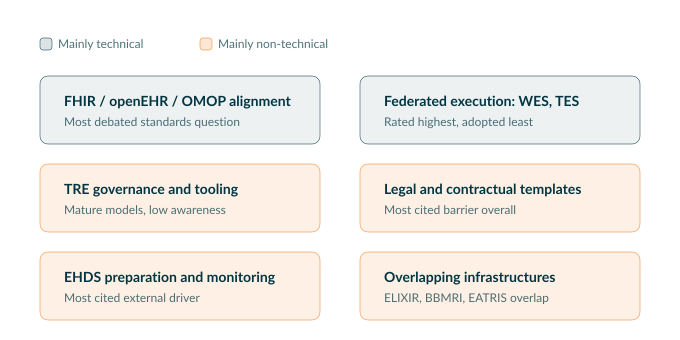

Convened by the [ELIXIR-UK Human Data and Tech Club](/activities/uk-human-data-community/)
**Chairs**: [Saskia Lawson-Tovey](/people/saskia-lawson-tovey/), [Tim Beck](/people/tim-beck/), [Wendi Bacon](/people/wendi-bacon/)

[Download it](https://doi.org/10.5281/zenodo.22795029)

## Executive summary

Across two workshops covering 19 ELIXIR Nodes and two Observer countries, the most frequently cited barriers to health data progress were not technical. Legal and regulatory complexity, the absence of national governance strategies and cross-sector coordination outweighed technical obstacles for most participants – described by one as “everything but the tech”. The European Health Data Space was referenced by almost every Node, making it the single most widely cited external driver of health data activity across the network.

This report sets out what Nodes are doing, where expertise already exists that others are looking for, and four recommendations:

- Develop a coordinated ELIXIR response to the European Health Data Space
- Explore the feasibility of a COST Action as a vehicle for sustained, funded knowledge exchange across the ELIXIR health data network
- Support immediate cross-Node health data knowledge exchange
- Develop practical guidance and resources, disseminated through ELIXIR services.

## Background

Both workshops took place at the ELIXIR All Hands Meeting 2026 and arose from ELIXIR’s Human Data and Translational Research (HDTR) scientific theme. The European Health Data Space (EHDS) provided an important part of the framing for both events: EHDS establishes a regulatory and infrastructure framework for health data reuse across Europe and is directly relevant to the infrastructure, standards and governance challenges Nodes are navigating. The workshops also served as a way of continuing to connect ELIXIR’s health data community following the end of the dedicated ELIXIR Health Data Focus Group.

The workshops were complementary in design: Workshop 1 concentrated on a specific and technically focused challenge, namely the adoption of health data standards across ELIXIR Nodes, while Workshop 2 took the broader question of cross-Node collaboration and peer support. Together they covered 19 ELIXIR Nodes and 2 Observer countries. Both used a format of short Node lightning-talk updates followed by small-group discussion, and this report draws on the Node presentations and the outputs of those discussions.

## Workshop 1: Bringing health data standards across Europe

Monday 8 June 2026 | 15 ELIXIR Nodes presented (CH, CZ, DE, EE, ES, FI, FR, GR, IE, IT, LU, PT, SE, SI, UK) | >100 participants

The workshop focused on current adoption of OMOP CDM, GA4GH standards (Beacon, Phenopackets, Data Connect, WES, TES, Passports/AAI), HL7 FHIR/openEHR, and TRE community specifications and tooling (SATRE, SACRO).  Fifteen Nodes gave structured updates on their standards adoption, followed by breakout group discussions. The main findings were:

- OMOP CDM is the most widely adopted clinical standard, with the majority of Nodes reporting regular or partial use; the most advanced implementations link OMOP to federated discovery infrastructure or EU project data pipelines.
- HL7 FHIR adoption is growing but remains fragmented at institutional rather than national level across most Nodes; openEHR is used alongside FHIR for interoperability in some Nodes, treating them as complementary. A FHIR-to-OMOP conversion tool developed within ELIXIR was highlighted as a transferable resource. The question of how FHIR, openEHR and OMOP relate to each other was the most actively debated topic.
- GA4GH Beacon is well established, particularly within the GDI context; Passports/AAI are among the more consistently adopted standards for federated access authorisation.
- GA4GH Phenopackets adoption is currently concentrated in rare disease research communities rather than broader clinical contexts.
- Federated execution standards, such as WES and TES, have limited adoption despite being cited as high priorities by breakout groups; a small number of Nodes have advanced implementations that could serve as peer-support partners.
- TRE community specifications and tooling, such as SATRE and SACRO, are largely unknown across the network despite being freely available and directly relevant to TRE programmes underway in many Nodes; multiple groups noted they had not previously encountered them.
- The dominant barriers to standards implementations are non-technical: lack of mandate or national coordination, resource constraints, the research/clinical institutional divide, and cultural resistance from hospital staff. Funded projects with clear use cases, ready-to-use toolkits, and EHDS as a policy driver were cited as the most effective enablers.

## Workshop 2: Connecting health data pan-Europe

Tuesday 9 June 2026 | 19 ELIXIR Nodes and 2 Observer countries presented (BE, CH, CZ, DE, EE, ES, FI, FR, GR, HU, IE, IT, LU, NL, NO, PT, SE, SI, UK; Observers: LV, PL) | >100 participants

The workshop asked how ELIXIR Nodes can help one another with health data. Each Node gave a two-minute lightning talk covering current activities and biggest challenges, followed by small-group discussions on how overlapping challenges could be addressed collectively. The main findings were:

- Nodes are converging on a shared set of European infrastructure programmes (FEGA, GDI, 1+Million Genomes) and technical building blocks (OMOP, FHIR, GA4GH standards) but at very different stages of maturity, with some Nodes operating production-scale infrastructure while others are at early development or planning stage.
- Many Nodes are independently building Trusted Research Environments or Secure Processing Environments, with limited awareness of approaches and governance frameworks already developed elsewhere in the network.
- The single most frequently cited barrier was legal and regulatory complexity, particularly differing national interpretations of GDPR and the time required for data protection and collaboration agreements. This was eloquently described as “everything but the tech”.
- The absence of a national health-data governance strategy or designated institutional lead was the primary constraint for some Nodes; other Nodes have navigated this and have established national models that could inform peers.
- Fragmentation of clinical and EHR systems across hospitals and regions was reported by the majority of Nodes, alongside a persistent gap between hospital-based clinical workflows and research infrastructure.
- Sustainable long-term infrastructure funding (as distinct from project-based funding) was a concern for around a third of participants.

## Cross-cutting themes across both workshops

### Non-technical barriers dominate

**Both workshops independently converged on the finding that the most significant barriers to health data progress are not technical.**

Workshop 2 identified legal complexity, governance gaps and funding sustainability as the dominant challenges. Workshop 1 identified lack of mandate, institutional resistance and resource constraints as the main barriers to standards adoption. Technical solutions alone, such as better tools, more standards or improved software, are unlikely to resolve these without parallel progress on governance, policy and institutional buy-in.

### The FHIR / openEHR / OMOP relationship needs clarity

**Nodes across the network are making different choices and in some cases spending energy debating the question rather than implementing.**

The question of how FHIR, openEHR and OMOP relate to one another, raised explicitly in Workshop 1, maps directly onto the standards fragmentation challenge identified in Workshop 2. Conversion tools that bridge between standards, and complementary-use models that assign each standard a distinct role, were discussed as practical approaches. A shared ELIXIR position that clarifies how these complement each other and when each is most appropriate, without mandating a single standard, could reduce this overhead for the whole network.

### Federated execution (WES/TES) is a shared priority with low current adoption

**WES and TES are the standards Nodes rate highest and use least.**

GA4GH WES and TES were cited as low-adoption but high-priority standards in Workshop 1, and the need for federated analytics across TREs was a recurring theme in Workshop 2. A small number of Nodes have advanced implementations that could serve as peer-support partners for those beginning to work in this space. A concrete workplan for promoting WES/TES adoption, linked to GDI and HDTR project contexts, could address a gap identified by both workshops simultaneously.

### EHDS creates both urgency and opportunity for the network

**EHDS was referenced by almost every Node, making it the single most widely cited external driver of health data activity.**

For some Nodes it is already functioning as a policy mandate for standards adoption and infrastructure investment; for others the timeline and practical requirements remain unclear. Across both workshops there was appetite for a more coordinated ELIXIR response: helping Nodes understand how their existing infrastructure maps onto EHDS requirements, positioning ELIXIR tools and approaches within national EHDS implementation plans, and presenting a coherent picture of what ELIXIR can offer to the EHDS ecosystem.

## Areas for potential collaboration

The following six opportunities are drawn from both workshops and reflect cases where experience or expertise in part of the network corresponds to a stated challenge or gap elsewhere.

### **1. TRE governance and tooling: building on established models**

**Connect early-stage Nodes with those running mature TREs.**

Many Nodes are building TREs for the first time while others have mature operational TRE infrastructure with documented governance and accreditation approaches. TRE architecture specifications such as SATRE and output checking toolkits such as SACRO are freely available and documented resources that have not yet reached much of the network, despite their direct relevance to TRE programmes underway in many Nodes. Wider dissemination of these resources was flagged as a priority by Workshop 1 breakout groups.

### **2. FHIR/OMOP/openEHR alignment**

**Produce ELIXIR guidance on the role of each standard and the tools that bridge them.**

The question of how to prioritise and integrate FHIR, openEHR and OMOP was the most actively discussed standards question in Workshop 1. Conversion tools that bridge between standards, and models that treat them as complementary for different purposes, are concrete examples that could inform ELIXIR guidance on how these standards relate and when each is most appropriate. This would benefit all Nodes currently navigating this question independently.

### 3. Federated execution: GA4GH WES and TES adoption

**Form a targeted peer-support cluster around the Nodes with the most advanced implementations.**

WES and TES are cited as high priorities but have limited adoption across most of the network. These standards are essential for enabling federated analysis across TREs, a goal shared by most Nodes. A targeted peer-support cluster, drawing on the Nodes with the most advanced WES and TES implementations, could help other Nodes in the GDI and HDTR context move from planning to implementation.

### 4. Sharing legal, contractual and data-sharing templates

**Build a contributed repository of template agreements and GDPR interpretations.**

Workshop 2 identified legal and contractual negotiation as the single most consistently cited barrier across all participating Nodes. The time required for data protection and collaboration agreements was described as the dominant non-technical constraint by multiple participants. A shared, contributed repository of template agreements, GDPR interpretations and lessons from completed negotiations could be a high-value, relatively low-cost collaborative output for the network.

### 5. EHDS preparation and shared monitoring

**Coordinate one ELIXIR response rather than 22 national interpretations.**

The European Health Data Space is a common reference point across almost every Node, yet most report significant uncertainty about how their national activities will align with EHDS requirements, including the roles and duties it will impose, timelines for implementation, and the position of non-EU Nodes. Coordinating ELIXIR’s collective response to EHDS, rather than each Node interpreting requirements independently, is one of the highest-value actions the network could take.

This includes shared monitoring of EHDS implementing acts and TEHDAS2 outputs, developing a common understanding of how existing ELIXIR infrastructure and standards map onto EHDS secondary-use requirements, and identifying where ELIXIR tools and approaches can be positioned within national EHDS implementation plans.

### 6. Coordinating across overlapping research infrastructures

**Set out how ELIXIR relates to BBMRI, EATRIS and EuroBioImaging in shared national space.**

Several Nodes described unclear divisions of responsibility between ELIXIR and other research infrastructures (BBMRI, EATRIS, EuroBioImaging) operating in the same national space. Workshop 1 raised a related point about ELIXIR’s mandate in the health/clinical space. A clearer ELIXIR-wide framework for how these infrastructures interrelate, and for how ELIXIR positions its role in standards advocacy, would help Nodes navigate this internally and externally.

## Recommended next steps

The following four recommendations apply across both workshops. The first reflects the prominence of the European Health Data Space as a shared external driver across the network; the remainder address the most consistently identified cross-cutting needs and opportunities.

### 1. Develop a coordinated ELIXIR response to the European Health Data Space

EHDS is the single most widely cited external driver across both workshops and creates both obligations and opportunities for ELIXIR Nodes. A shared programme of work should include: monitoring EHDS implementing acts and TEHDAS2 outputs centrally and disseminating summaries across all Nodes; mapping existing ELIXIR infrastructure, tools and standards onto EHDS secondary-use requirements so Nodes can draw on this when engaging with national authorities; and identifying where ELIXIR approaches can be embedded in national EHDS implementation plans. This coordination work requires no new infrastructure and could begin immediately.

We propose that an ELIXIR Focus Group application should be formed so that we can provide the ELIXIR Director with direction and clarity on the requirements of the ELIXIR Nodes and Communities in this space, on how ELIXIR’s role relates to neighbouring research infrastructures such as BBMRI, EATRIS and EuroBioImaging operating in the same national health data space, and on what ELIXIR can provide overall.

### 2. Explore the feasibility of a COST Action as a vehicle for sustained, funded knowledge exchange across the ELIXIR health data network

A COST Action could support networking meetings, training schools and joint outputs. To be competitive, any proposal must be built around a single, clearly articulated problem and a specific set of intended outputs rather than a general remit to share knowledge.

Nodes interested in taking this forward should agree on the primary problem the Action will address, what concrete outputs would constitute success, which Nodes are essential to that specific aim, and how the scope is distinct from existing structures such as 1+MG, GDI, EHDS working groups and OHDSI. A short scoping discussion producing a one-page statement of aim and intended outputs is a practical first step.

### 3. Support immediate cross-Node health data knowledge exchange

Nodes should be supported to learn directly from one another’s experience in health data infrastructure, governance and standards implementation. Both workshops identified clear cases where expertise and working solutions exist in parts of the network that other Nodes are actively seeking.

Existing ELIXIR mechanisms such as Travel Grants and Staff Exchanges provide ready vehicles for this and should be actively promoted for health data purposes. In addition, if a Focus Group was formed we would be able to ensure these discussions would continue post the workshops held.

### 4. Develop practical guidance and resources, disseminated through ELIXIR services

Two outputs should be developed as priorities:

- Guidance on the FHIR/openEHR/OMOP relationship, clarifying how these standards complement each other and when each is most appropriate
- A set of contributed legal and contractual templates, governance documentation and standards-implementation guides.
- These  could be disseminated through ELIXIR services, such as the FAIR Cookbook and RDMkit.  The RDMkit health data page ([rdmkit.elixir-europe.org/health_data](https://rdmkit.elixir-europe.org/health_data)) already covers many of the standards discussed across both workshops, and both services accept community contributions.

---

**Abbreviations used in this report**

- AAI: Authentication and Authorisation Infrastructure
- BBMRI: Biobanking and BioMolecular resources Research Infrastructure
- COST: European Cooperation in Science and Technology
- EATRIS: European Infrastructure for Translational Medicine
- EHDS: European Health Data Space
- EHR: Electronic Health Record
- FAIR: Findable, Accessible, Interoperable, Reusable
- FEGA: Federated European Genome-phenome Archive
- HL7 FHIR: Health Level Seven International Fast Healthcare Interoperability Resources
- GA4GH: Global Alliance for Genomics and Health
- GDI: Genomic Data Infrastructure
- GDPR: General Data Protection Regulation
- HDTR: Human Data and Translational Research
- OHDSI: Observational Health Data Sciences and Informatics
- OMOP CDM: Observational Medical Outcomes Partnership Common Data Model
- SACRO: Semi-Automated Checking of Research Outputs
- SATRE: Standard Architecture for Trusted Research Environments
- TEHDAS2: Towards the European Health Data Space, second joint action
- TES: Task Execution Service
- TRE: Trusted Research Environment
- WES: Workflow Execution Service
[Download it](https://doi.org/10.5281/zenodo.22795029)

**Cite this article**:
Lawson-Tovey, S., Beck, T., & Bacon, W. (2026). Connecting Health Data Across Europe: A report from two health data workshops at the ELIXIR All Hands Meeting 2026. Zenodo. ELIXIR All Hands 2026 (AHM 2026), Lyon, France. <https://doi.org/10.5281/zenodo.22795029>
